# Azure Healthcare Claims and Pharmacy Analytics Platform

A medallion lakehouse for synthetic US medical claims, pharmacy claims, eligibility, and drug pricing. The transformation code is the same library a Databricks job imports. It runs locally and in GitHub Actions on PySpark and Delta Lake. Azure Data Factory, Auto Loader, Lakeflow / Delta Live Tables, Unity Catalog, Key Vault, Bicep, and the Power BI model are written as deploy-ready artifacts. They were not executed against a live subscription or the Power BI service.

The dataset is synthetic. Identifiers follow NPI and NDC shapes. There is no real PHI.

## Business problem

A payer that also administers a pharmacy benefit needs one reconciled view of medical cost, drug spend, denials, and contracted reimbursement. Source files arrive daily, late, and dirty: adjustments and reversals change paid amounts, pharmacies and providers change network status, MAC prices move, and a new prior-authorization attribute shows up without a schema migration window.

The platform has to:

- land each daily batch once, and survive a rerun without duplicating claims
- quarantine rows that fail format, range, check-digit, or referential checks
- keep provider, pharmacy, and price history (SCD Type 2) so a May fill still prices against the contract in effect that day
- apply the latest claim version and ignore a stale replay of an older version
- accept a new column without rewriting history to a fake value
- prove row counts and dollar totals from landing through gold, and fail the run when they do not match
- publish a star schema a finance analyst can use for PMPM, denial rate, generic dispensing rate, and pharmacy reimbursement variance

## What actually ran

On this machine, with Java 21, Python 3.12, PySpark 3.5.5, and delta-spark 3.2.1:

| Step | Result |
| --- | --- |
| `generate --scale small --seed 42` | Four daily batches under `data/sample` |
| `run --env dev` | `SUCCESS`, run `20261027T210516Z-121230cd` |
| Reconciliation | 70 checks, 0 failed, tolerance $0.01 |
| Bronze rows | 2,902 |
| Current silver claims | 668 (387 medical lines, 281 pharmacy lines) |
| Quarantine | 23 distinct records, 47 rule violations |
| Gold total paid | $701,390.62 |
| Schema evolution | `prior_auth_number` on 2024-06-06 only; 66 silver medical rows carry a value; earlier batches stay null |

Screenshots below are from that run and from the local dashboard over those Gold tables. There are no pictures of the Azure portal, Databricks, ADF, or Power BI, because those services were not available.

## Architecture

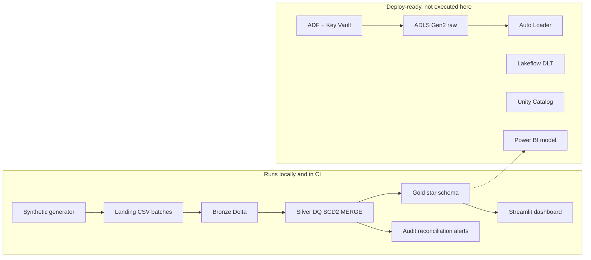

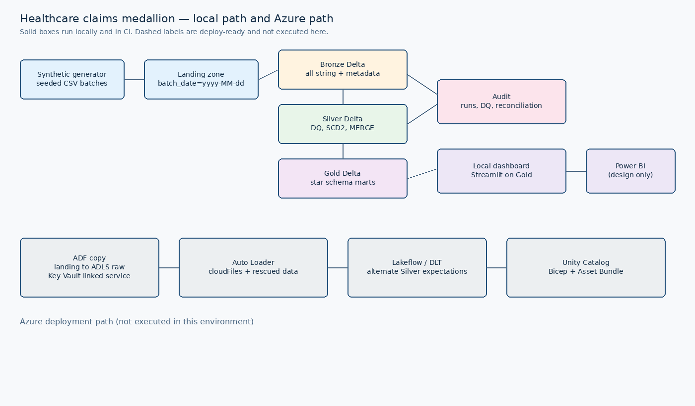

Details: [docs/architecture.md](docs/architecture.md), [docs/data-flow.md](docs/data-flow.md).

## Tech stack

| Piece | How it is used |
| --- | --- |
| Python 3.12 | Generator, CLI, tests, dashboard |
| PySpark 3.5 + Delta Lake 3.2 | Local and CI medallion engine |
| SQL | Gold views, payer queries, Unity Catalog DDL |
| Azure Data Factory | Parameterized copy from landing to ADLS raw, Key Vault linked service, tumbling-window trigger, Databricks job activity |
| ADLS Gen2 | `abfss://` paths when `HC_STORAGE_MODE=adls` |
| Databricks | Auto Loader notebook, shared `run_pipeline`, Asset Bundle |
| Lakeflow / DLT | Alternate Silver expectations pipeline |
| Unity Catalog | Catalogs, schemas, grants, external locations |
| Azure Key Vault | Secret scope `hc-kv-<env>`; local mode reads the environment |
| Power BI | Semantic model and DAX in [docs/powerbi.md](docs/powerbi.md). No `.pbix` |
| GitHub Actions | CI runs lint, generator smoke, and the full local pytest suite. CD skips when Azure secrets are absent |
| Bicep | Storage, Key Vault, Data Factory, Databricks workspace, access connector |

## Data model

Landing entities: members, providers, pharmacies, drugs, drug pricing (AWP, WAC, MAC), prescriptions, medical claims, pharmacy claims, remittances.

Silver current grain for claims is `claim_id + claim_line_number`. Every accepted version is also stored. Providers, pharmacies, and drug prices are SCD Type 2 with `effective_start`, `effective_end`, and `is_current`. The first snapshot opens on 2020-01-01 so service dates before the first batch still resolve.


Full write-up: [docs/data-model.md](docs/data-model.md).

## Layer-by-layer flow

1. **Generate.** Faker and NumPy, seed 42. Scales `tiny` (tests), `small` (committed sample), `medium` (5,000 members, not committed).
2. **Ingest.** Local parser mirrors Auto Loader: schema location, `addNewColumns`, `_rescued_data` for `##CORRUPT##` lines, stable `ingest_record_id`.
3. **Bronze.** All strings plus ingest metadata. Replay dedupes on `ingest_record_id`.
4. **Silver.** Typed parse, DQ split, referential checks, SCD2, claim MERGE.
5. **Gold.** Full rebuild from current silver: facts at claim-line grain, then PMPM, denials, GDR, top drugs, reimbursement variance, prescribing, and member utilization.
6. **Audit.** Run row, DQ metrics, schema-change events, reconciliation, alerts. JSONL logs under `data/logs`.

Batch contents:

| Batch | Purpose |
| --- | --- |
| 2024-06-03 | Baseline |
| 2024-06-04 | SCD2 changes: specialty, network, pharmacy tier, MAC price |
| 2024-06-05 | Late claims, duplicate pharmacy claims, adjustments, bad rows, corrupt lines |
| 2024-06-06 | `prior_auth_number`, a reversal, and a stale version-1 replay |

## Engineering features

**Incremental.** `_checkpoints/ingestion.json` records a batch only after silver commits. A rerun skips completed batches. `--force` replays them. The integration test deletes nothing and still replays with `--force`; current claim counts stay the same.

**MERGE.** A higher `claim_version` replaces the current line. An equal version with the same hash is a no-op. A lower version does not roll an adjustment back. Example from the small run: `MC2024060300003` line 1 version 1 paid $185.74 (Original, batch 2024-06-03) and version 2 paid $213.60 (Adjustment, batch 2024-06-05). `MC2024060300005` version 3 is a reversal with paid $0.00.

**SCD2.** Provider `1764480624` moves from Family Medicine to Internal Medicine on 2024-06-04 (prior row closes 2024-06-03). Provider `1597777519` moves IN to OUT the same day. Provider `2453197644` is Suspended on 2024-06-06. Harborlight Pharmacy (`1049147279`) moves Preferred to Standard. MAC `00069015001` moves from 0.2300 (`MAC-COMM-2024`) to 0.2400 (`MAC-COMM-2024-R1`). MAC `00002143301` moves from 0.2000 to 0.2100 on 2024-06-06.

**Data quality.** Null, format, range, NPI check digit, NDC shape, and referential rules. Failures go to `silver.quarantine` (one row per rule) and `audit.dq_metric`. A fail rate above 5% raises `DQ_FAIL_RATE` and does not fail the job. On 2024-06-05 the small run quarantined 10 of 112 medical rows, 7 of 80 pharmacy rows, 2 of 26 providers, and 1 of 11 pharmacies. Two `RESCUED_RECORD` rows came from planted `##CORRUPT##` lines.

**Schema evolution.** Bronze gains `prior_auth_number` on 2024-06-06 (67 medical rows non-null that day, zero on earlier batches). `SCHEMA_EVOLVED` is written to `audit.alert`. Silver always projects the column so hashes stay stable.

**Reconciliation.** Landing line counts, bronze versus accepted-plus-quarantined amounts, version history, current grain, gold paid versus silver, SCD2 overlap and current-flag checks, member and remittance totals. This run: 70 PASS. A miss raises `ReconciliationError` after the audit table is written.

**Recovery.** `run --fail-after silver` commits batches, marks the run failed, and skips gold. The next run rebuilds gold and does not duplicate claims. `--force` replays landing files; bronze dedupe and MERGE keep the grain unique. Gold is rebuilt every run, so a bad gold folder can be deleted and regenerated. Delta concurrent-write conflicts are retried. Simulated failures and reconciliation errors are not.

**Monitoring.** `audit.pipeline_run` stores start, end, status, and row counts. Logs are plain text plus JSONL. Optional `ALERT_WEBHOOK_URL`. A webhook failure does not fail the pipeline.

## Sample analytics

Small book, seed 42, 242 members (240 at baseline plus 2 added on the second batch), service months May and June 2024. A few institutional claims dominate PMPM at this volume. That is a property of the synthetic generator, not a commercial benchmark.

| Month | Line of business | Member months | Total paid | PMPM |
| --- | --- | --- | --- | --- |
| 2024-05 | Commercial | 135 | $240,991.96 | $1,785.13 |
| 2024-05 | Medicaid | 40 | $64,543.80 | $1,613.60 |
| 2024-05 | Medicare Advantage | 65 | $156,868.25 | $2,413.36 |
| 2024-06 | Commercial | 137 | $114,479.42 | $835.62 |
| 2024-06 | Medicaid | 40 | $56,172.73 | $1,404.32 |
| 2024-06 | Medicare Advantage | 65 | $68,334.46 | $1,051.30 |

Denial rate (denied / adjudicated claims):

| Month | Medical | Pharmacy |
| --- | --- | --- |
| 2024-05 | 11.1% (22 / 199) | 11.0% (13 / 118) |
| 2024-06 | 9.8% (9 / 92) | 7.4% (12 / 163) |

Top denial codes by claim count: CO-16 (7), NCPDP-70 (7), NCPDP-79 (5), NCPDP-88 (5).

Generic dispensing rate on paid, non-reversed fills: May 84 / 105 = 80.0% ($25,510.68 pharmacy paid), June 113 / 151 = 74.8% ($48,903.24).

Top drugs by plan paid: Adalimumab $70,712.00 (12 fills, brand), Apixaban $1,765.76, Albuterol HFA $426.60, Insulin Glargine $235.64, Fluticasone Nasal $172.24.

Pharmacy reimbursement variance versus contracted MAC/WAC/AWP plus the tier fee is small at retail (Harborlight Preferred $19.80 and Standard $6.00, split by the 2024-06-04 tier change) and concentrated at Summit Specialty Pharmacy ($2,258.40), which is where the specialty ingredient cost sits.

Member utilization covers 220 members with claims, 48 ER visits (place of service 23), and 25 inpatient admits (place of service 21).

Prescriber paid amount is highest in Pulmonology ($18,397.60), Pediatrics ($17,299.28), and Cardiology ($12,890.80).

## Repository layout

```text
src/hc_platform/     generator, ingest, silver, gold, audit, pipeline, CLI
conf/                dev, test, prod settings
data/sample/         committed small dataset and manifest
sql/                 DDL notes, gold views, payer queries, Unity Catalog
notebooks/           Auto Loader and shared silver/gold job
dlt/                 Lakeflow / DLT alternative
adf/                 linked services, datasets, pipeline, trigger
infra/               Bicep and parameter files
dashboard/           local Streamlit app
tests/               unit tests and the tiny end-to-end run
docs/                architecture, data model, deployment, runbook, Power BI
.github/workflows/   CI and guarded CD
```

## Local quickstart

Requires Python 3.11+ and a JDK (17 or 21). Java is used by PySpark.

```bash
make setup
make generate
make pipeline
make test
make dashboard
```

`make generate` rewrites `data/sample` (small, seed 42). The copy in git is that dataset, so a reviewer can skip generation and run `make pipeline` after `make setup`.

Useful overrides:

```bash
HC_LANDING=data/sample HC_LOCAL_ROOT=data/lake HC_LOG_DIR=data/logs \
  .venv/bin/python -m hc_platform.cli run --env dev

.venv/bin/python -m hc_platform.cli generate --scale medium --output /tmp/hc-medium --seed 42
```

Set `HC_STORAGE_MODE=adls` and `HC_CATALOG_MODE=unity` only on a Databricks cluster that can see the lake. Dev defaults stay on the local filesystem so a laptop run does not try to open `abfss://`.

Dashboard: http://localhost:8501 after `make dashboard`. It reads `data/lake/gold`. The caption on the page states that Power BI is the production target.

## Azure deployment

Step-by-step: [docs/deployment.md](docs/deployment.md). Operations: [docs/runbook.md](docs/runbook.md).

Short version: deploy `infra/main.bicep`, create Key Vault secrets and a Databricks secret scope, run `sql/unity_catalog/01_catalog.sql`, `databricks bundle deploy -t dev`, import `adf/` JSON, and connect Power BI to `sql/analytics/gold_views.sql` using the DAX in [docs/powerbi.md](docs/powerbi.md).

## Testing

```bash
make test
```

Unit tests cover NPI/NDC validation, config path switching, retry behavior, the landing parser (rescued rows and new columns), SCD2 open/close/idempotency, claim MERGE idempotency and stale versions, and reconciliation tolerance.

`tests/test_integration.py` generates a tiny dataset and:

1. fails the run after silver (`--fail-after silver`)
2. reruns, skips the four committed batches, builds gold, and requires reconciliation PASS
3. replays with `--force` and requires the same medical and pharmacy grain

## CI/CD

`.github/workflows/ci.yml` installs Java 21 and Python 3.12, runs Ruff, validates ADF JSON and the bundle YAML, smoke-generates a tiny dataset, and runs pytest with coverage. The integration test is the full local pipeline, so CI does not run a second copy.

`.github/workflows/cd.yml` targets GitHub environments `dev` and `prod`. If `AZURE_CLIENT_ID` or the Databricks host and token are empty, the job logs a skip and succeeds. Prod runs only from `workflow_dispatch`.

## Screenshots from the local run

Pipeline stdout (small scale):

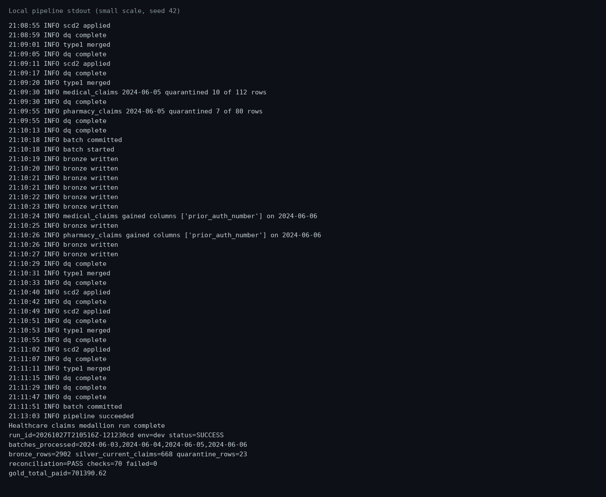

Pytest (17 passed, 94% coverage on `hc_platform`):

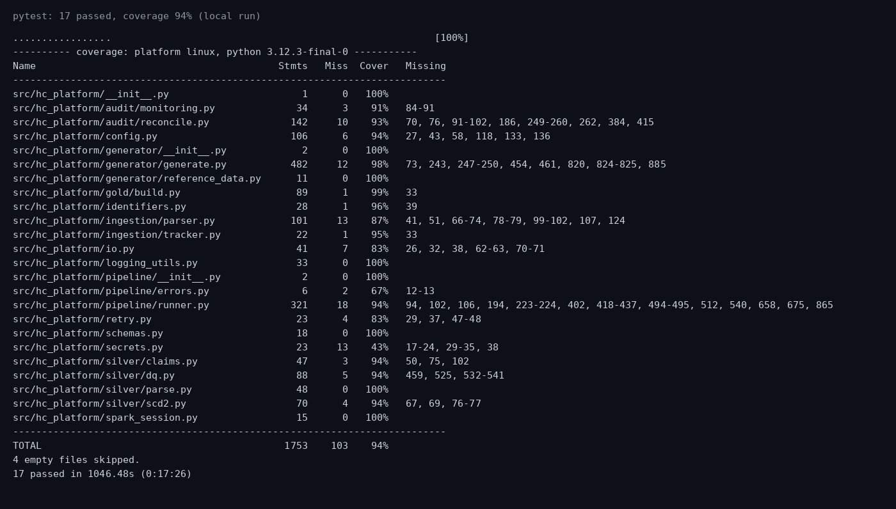

Reconciliation sample (70 PASS / 70 checks on this run):

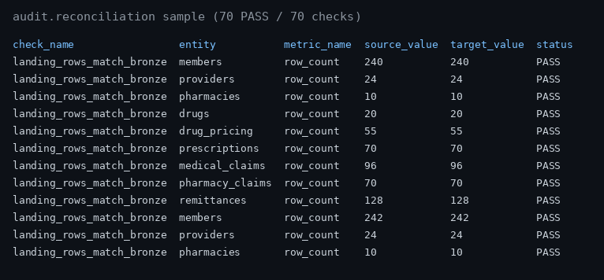

Quarantine rules:

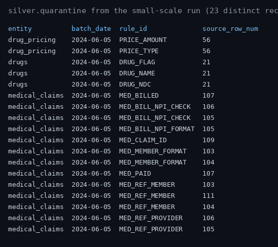

SCD2 provider history:

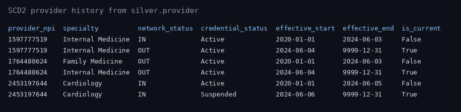

PMPM table:

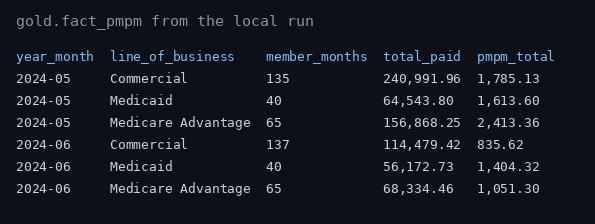

Local Streamlit dashboard (`make dashboard`) on the Gold Delta tables from this run. This is not a Power BI screenshot. Power BI remains the production target in [docs/powerbi.md](docs/powerbi.md).

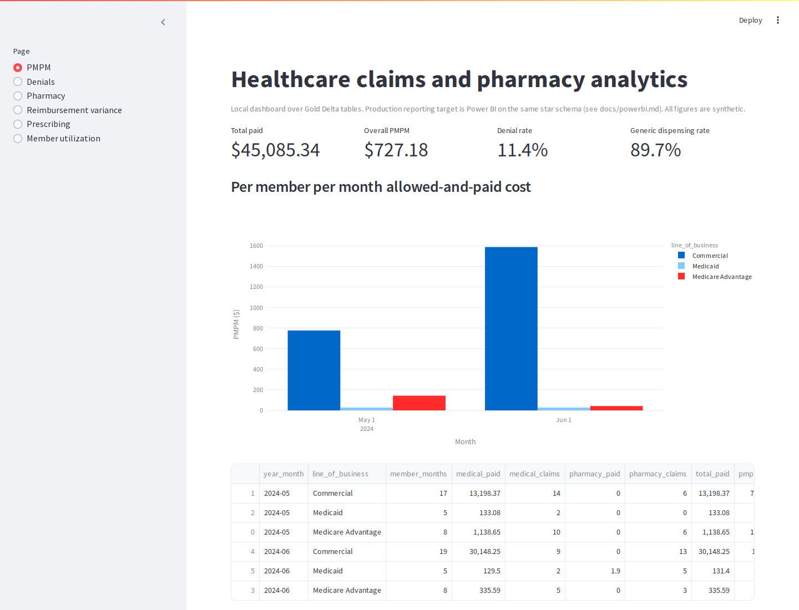

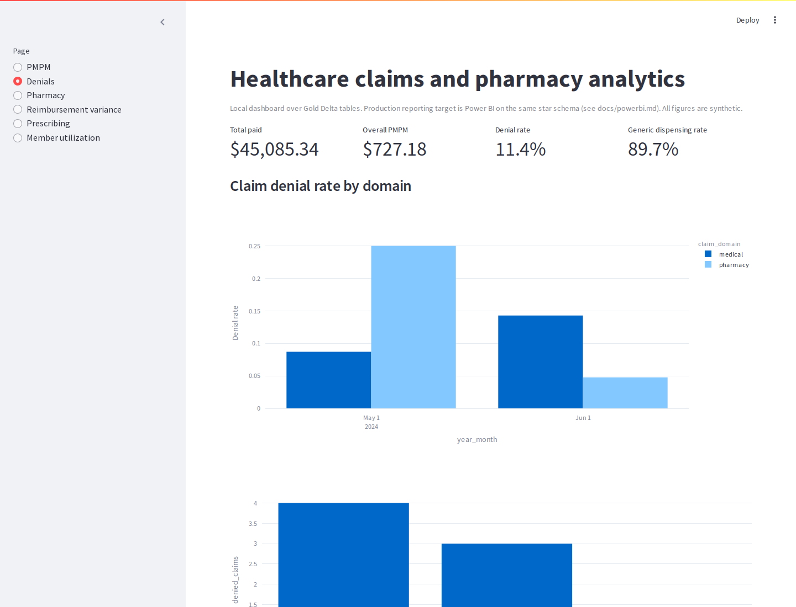

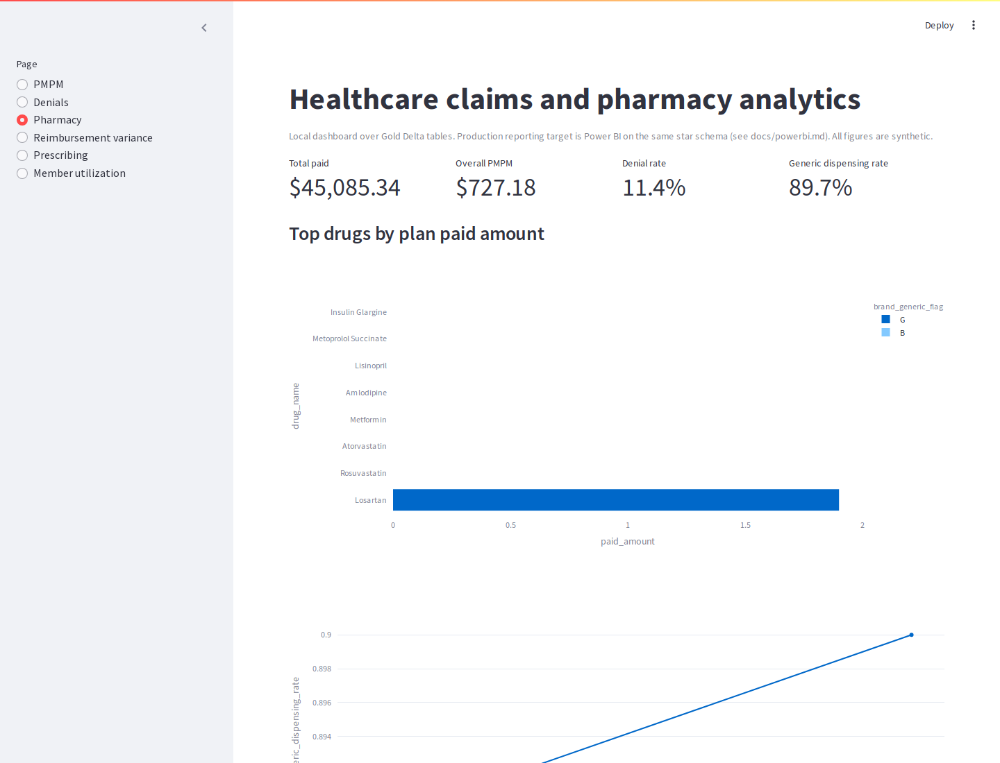

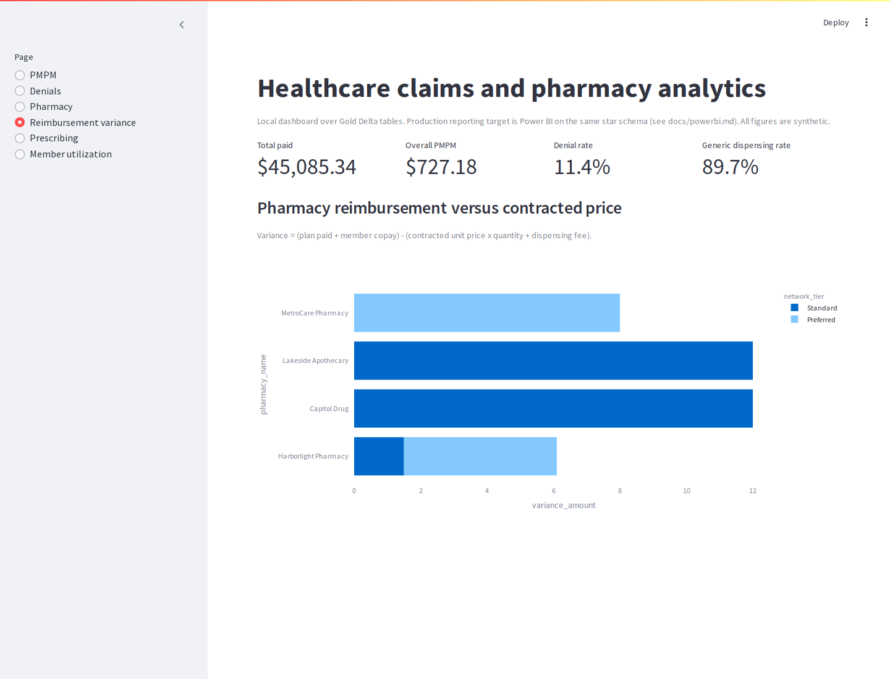

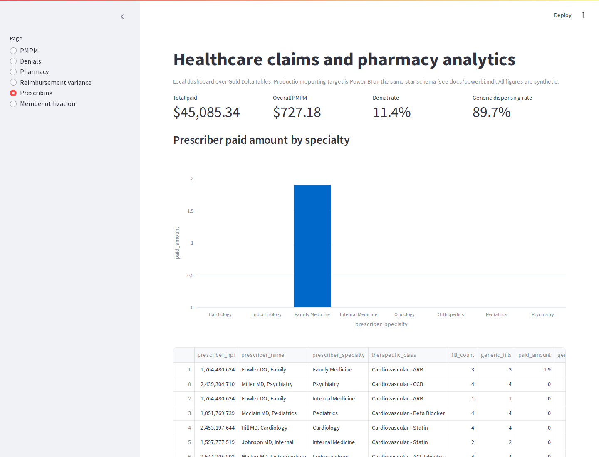

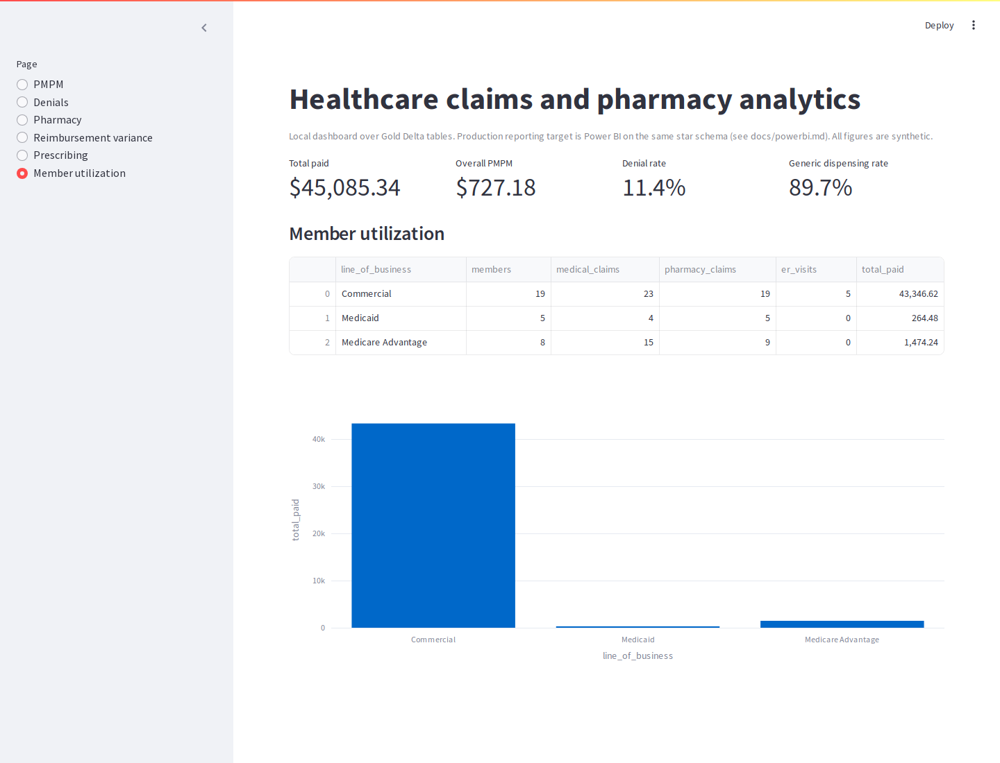

The same frames exported with matplotlib:

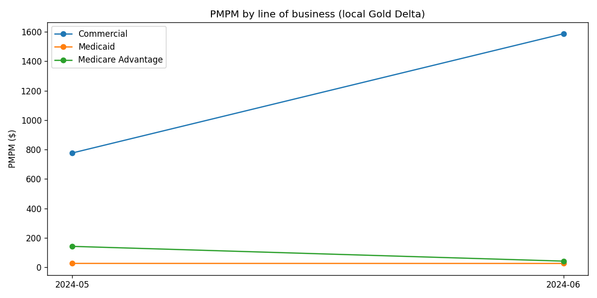

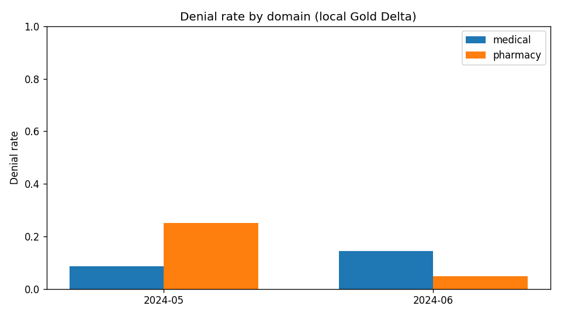

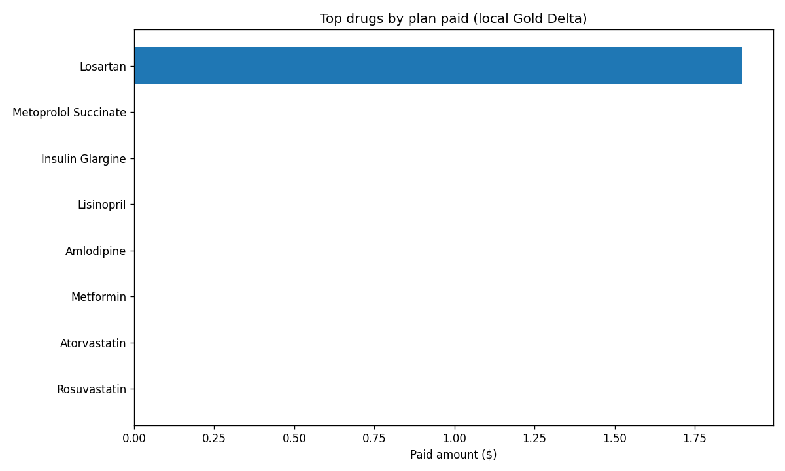

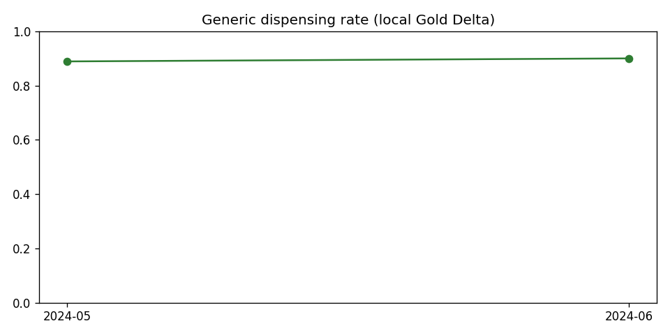

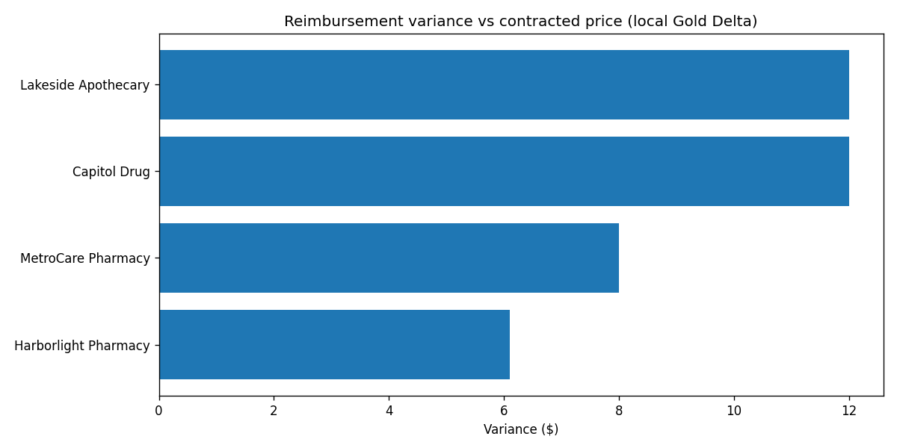

## Challenges

**Pharmacy paid collapsed to zero.** A flat copay was larger than the ingredient cost of cheap generics, so plan paid became $0 and GDR looked empty. The generator now uses a percent-of-cost copay with a cap (generic 20% up to $10, brand 20% up to $40, specialty 10% up to $150). The numbers in this README are from the run after that change. Adalimumab still dominates drug spend, which is what a specialty claim should do.

**MAC changes that did not change the price.** Integer-cent math turned a 4% increase of a $0.20 MAC into the same $0.20. The generator now moves the price by at least one cent, which is why `00002143301` shows 0.2000 then 0.2100.

**Schema evolution versus MERGE hashes.** Silver always projects `prior_auth_number`. Bronze is where the new column appears. Earlier batches stay null instead of being backfilled.

**Gold drift.** Late adjustments change paid amounts. Gold is rebuilt from silver current state on every success so aggregates cannot lag the claim grain. The cost is a longer gold step, which is acceptable at this volume.

**Spark overhead.** Four batches and nine entities produce many small actions. A tiny dataset and a small dataset take a similar wall-clock time because the driver, not the row count, dominates. CI runs that path once.

## Results

The local platform takes a seeded landing zone through bronze, silver, and gold with a hard reconciliation gate. On the committed small dataset that gate passed 70 of 70 checks, quarantined the planted bad rows, kept three provider history breaks and two MAC price breaks, and published $701,390.62 of paid cost across May and June. A reviewer can clone the repo, run `make setup`, `make pipeline`, and `make test`, and see the same grain.

## Future work

- Execute Bicep, the Asset Bundle, and the ADF pipeline in a real subscription and replace this section with the workspace URL.
- Add a Databricks workflow task that installs the wheel, so the bundle is one-command from an empty workspace.
- Stream gold marts incrementally once volumes leave the "rebuild is cheaper" range.
- Point Auto Loader at the landing container in a dev workspace and compare its bronze row counts with the local parser on the same files.
- Build the Power BI file from `docs/powerbi.md` once a workspace exists.

## Honest boundary

| Ran here | Deploy-ready, not run against Azure |
| --- | --- |
| Generator, local parser, Delta bronze/silver/gold | ADF pipelines, datasets, triggers, Key Vault linked service |
| DQ, SCD2, MERGE, schema evolution, reconciliation, rerun | `cloudFiles` Auto Loader notebook |
| Streamlit dashboard and the chart images | Lakeflow / DLT pipeline |
| GitHub Actions CI definition | Unity Catalog SQL, secret scopes |
| | Bicep, Asset Bundle deploy, CD apply |
| | Power BI service |
