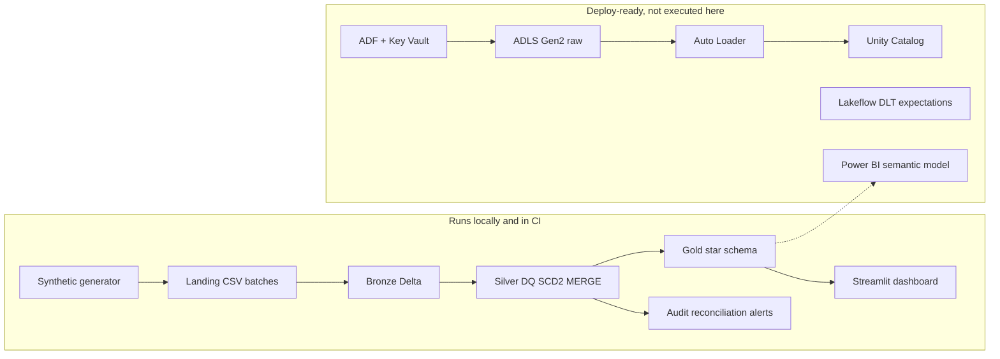

# Architecture

The platform is a medallion lake for a synthetic commercial, Medicare Advantage, and Medicaid book of business. A pharmacy benefit component sits next to medical claims so a payer analytics team can see medical cost, drug spend, generic dispensing, and contracted reimbursement in one model.

Two execution paths share the transformation library in `src/hc_platform`:

1. **Local and CI.** PySpark plus Delta Lake on the filesystem. Landing CSVs are parsed with the same schema-evolution and rescued-data contract Auto Loader uses. This path is what the tests run.
2. **Azure.** ADF copies a daily batch into ADLS Gen2. A Databricks job runs Auto Loader into bronze, then `run_pipeline` with `HC_STORAGE_MODE=adls` and `HC_CATALOG_MODE=unity`. Lakeflow / Delta Live Tables is an alternate Silver implementation. That path is written as deployable artifacts. It has not been executed against a subscription.

Source SVG: [diagrams/architecture.svg](diagrams/architecture.svg).

## Configuration boundary

`conf/dev.yml`, `conf/test.yml`, and `conf/prod.yml` hold every environment switch:

| Setting | Local default | Azure |
| --- | --- | --- |
| `storage.mode` | `local` | `adls` (`abfss://`) |
| `catalog.mode` | `local` (Delta path) | `unity` (`catalog.schema.table`) |
| `secrets.mode` | environment variable | `dbutils.secrets.get` on scope `hc-kv-<env>` |

`HC_STORAGE_MODE`, `HC_CATALOG_MODE`, `HC_ADLS_URI`, and `HC_CATALOG_NAME` override the YAML placeholders.

## Layer responsibilities

**Landing.** One folder per batch date. Nine CSV files. The generator plants duplicates, late claims, adjustments, reversals, malformed identifiers, and one corrupt line. The 2024-06-06 batch adds `prior_auth_number`.

**Bronze.** All columns stored as strings, plus `ingest_record_id`, `source_file`, `batch_date`, and rescued-data columns. Replay overwrites by `ingest_record_id`, so a restarted batch does not double-count. New columns are unioned with `allowMissingColumns` and the table schema is overwritten. The schema registry under `_schemas` records the header the way Auto Loader's schema location does.

**Silver.** Typed columns, data-quality split, SCD Type 2 for providers, pharmacies, and drug prices, and Delta MERGE for claims. Bad rows land in `silver.quarantine`, one row per failed rule. Accepted claim versions land in `medical_claim_version` / `pharmacy_claim_version`. The current table keeps the highest version per claim line.

**Gold.** Rebuilt from current silver on every successful run. Facts stay at claim-line grain so paid amounts can be tied back to silver before they roll into PMPM, denial, GDR, drug spend, reimbursement variance, prescribing, and member utilization marts.

**Audit.** `pipeline_run`, `reconciliation`, `dq_metric`, `processed_file`, `schema_change`, and `alert`. A webhook posts when `ALERT_WEBHOOK_URL` is set. A failed post does not fail the pipeline.

## Why Gold is rebuilt

Aggregate marts are small relative to the claim grain. Rebuilding them from silver current state avoids drift when a late adjustment changes a paid amount, and it makes a crash during the gold step recoverable by deleting the gold folder and rerunning. Silver and bronze merges stay incremental.
