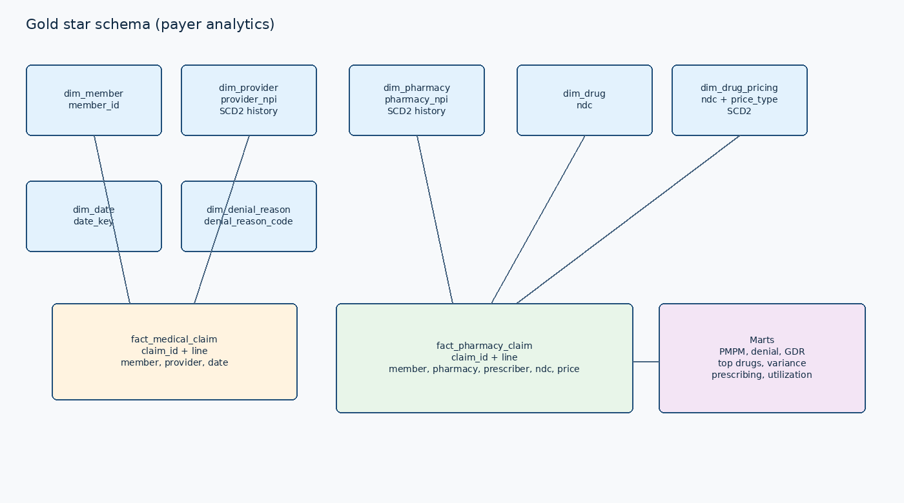
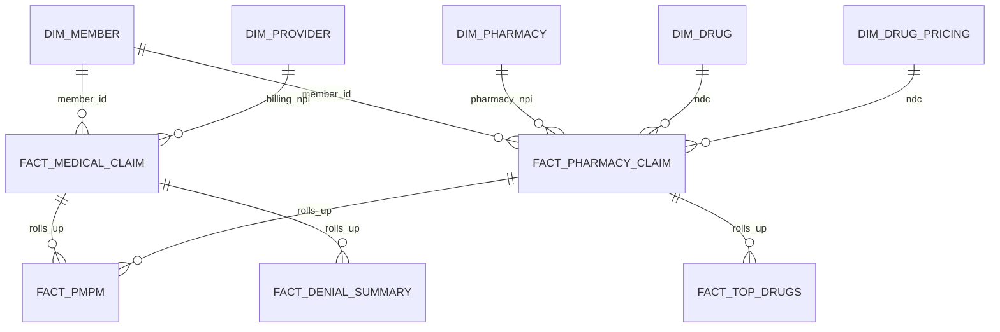

# Data model

All identifiers are synthetic. NPIs use the CMS Luhn check digit over prefix `80840`. NDCs are 11-digit invented codes. Member ids match `M` plus eight digits. No real PHI is generated or stored.

## Landing entities

| Entity | Grain | Notes |
| --- | --- | --- |
| members | member_id | Eligibility, plan, line of business, coverage dates |
| providers | provider_npi | Specialty, taxonomy, network, credential status. SCD2 |
| pharmacies | pharmacy_npi | NCPDP, chain, tier. SCD2 |
| drugs | ndc | Brand/generic flag, class, strength |
| drug_pricing | ndc + price_type | AWP, WAC, MAC and contract id. SCD2 |
| prescriptions | rx_id | Written prescription tied to a fill |
| medical_claims | claim_id + line + version | Professional and institutional lines |
| pharmacy_claims | claim_id + line + version | Ingredient cost, fee, copay, generic flag |
| remittances | remittance_id | Payment advice for an adjudicated line |

`prior_auth_number` is absent until batch `2024-06-06`.

## Silver keys

- Current medical and pharmacy claims: `claim_id`, `claim_line_number`.
- Version history: `claim_id`, `claim_line_number`, `claim_version`.
- SCD2: business key plus `effective_start`. `effective_end = 9999-12-31` and `is_current = true` mark the open row.
- Quarantine: `quarantine_id` = hash of `ingest_record_id` and `rule_id`.

A claim update is applied when the incoming version is higher, or when the version matches, the hash differs, and the source batch date is at least the stored batch date. A replay of an older version does not roll an adjustment back.

## Gold star

SVG: [diagrams/erd.svg](diagrams/erd.svg).

Dimensions: `dim_member`, `dim_provider`, `dim_provider_history`, `dim_pharmacy`, `dim_pharmacy_history`, `dim_drug`, `dim_drug_pricing`, `dim_date`, `dim_denial_reason`.

Facts: `fact_medical_claim`, `fact_pharmacy_claim`, `fact_pmpm`, `fact_denial_summary`, `fact_denial_reason`, `fact_generic_dispensing`, `fact_drug_spend`, `fact_top_drugs`, `fact_reimbursement_variance`, `fact_provider_prescribing`, `fact_member_utilization`.

Pharmacy contracted price is the current MAC (then WAC, then AWP) for generics, and AWP times `(1 - brand discount)` for brands. The brand discount is `pipeline.brand_awp_discount` (0.16). Preferred pharmacies add a $1.00 fee schedule and standard pharmacies $0.50. Variance is `(paid + copay) - (contracted unit * quantity + fee)`.

PMPM uses member months from coverage dates crossed with claim months, split by line of business.
